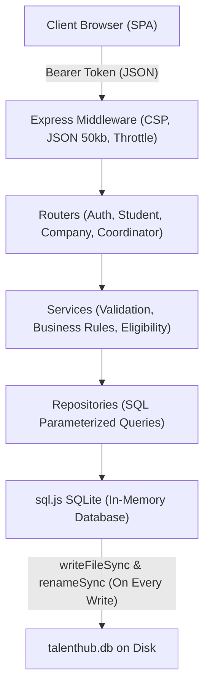
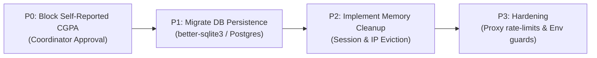

# TalentHub Application Security Audit Report

**Target Project:** `C:\Users\janag\Downloads\talenthub2\talenthub`  
**Application Stack:** Node.js, Express, SQLite (`sql.js`), Vanilla JS  
**Audit Scope:** Authentication, Authorization (RBAC/BOLA), Injection Defense, Data Integrity, Denial of Service (DoS)

---

## 1. Executive Summary & Security Scorecard

TalentHub was evaluated against standard web application security benchmarks (OWASP Top 10). The codebase implements modern defensive practices in several core areas (complete parameterization of SQL queries, safe DOM rendering, constant-time password verification), but has critical architectural and business logic risks regarding **unverified academic data** and **event-loop blocking database persistence**.

### Overall Posture Matrix

| Evaluation Dimension | Rating | Primary Observation |
| :--- | :---: | :--- |
| **SQL Injection (SQLi)** | 🟢 Excellent | Prepared statements used throughout all repositories (`?` bindings). |
| **Cross-Site Scripting (XSS)** | 🟢 Excellent | Safe DOM construction via `textContent`; restrictive Content Security Policy. |
| **Cross-Site Request Forgery (CSRF)** | 🟢 Good | Bearer token authorization stored in `sessionStorage` (no cookie ambient auth). |
| **Password & Token Security** | 🟢 Good | `scrypt` hashing with unique 16-byte salts and `crypto.timingSafeEqual`. |
| **Authorization & RBAC** | 🟡 Moderate | Role checks present; object-level authorization (`ownJob`, `ownApplication`) enforced. |
| **Data Integrity & Trust Model** | 🔴 Critical | Self-registration allows students to input arbitrary CGPA and backlogs without verification. |
| **Availability & DoS Resilience** | 🔴 Critical | Synchronous full-database export and write on every mutation freezes the event loop. |

---

## 2. Architecture & Threat Model

---

## 3. Detailed Vulnerability Findings

### Finding 1: Unverified Self-Reported Academic Data (Bypasses Eligibility Gates)
- **Severity:** 🔴 **HIGH / BUSINESS LOGIC**
- **Location:** `src/services/authService.js` (lines 25–42), `src/routers/authRouter.js` (line 11)
- **Description:** When a student creates an account, they provide their own `cgpa` and `active_backlogs`. The system trusts these client-provided values implicitly and saves them directly to the database.
- **Impact:** Gating mechanisms implemented in `src/services/eligibility.js` become ineffective. Any candidate can register with a fabricated 10.0 CGPA and 0 backlogs to bypass company cutoffs and apply for restricted listings.
- **Recommended Remediation:**
  1. Default newly registered student records to an `unverified` status.
  2. Implement a coordinator approval workflow or administrative batch import for official university grades and backlog records.

---

### Finding 2: Synchronous Full-Database Serialization on Mutations (DoS)
- **Severity:** 🔴 **HIGH / AVAILABILITY**
- **Location:** `src/db.js` (lines 24–32)
- **Description:** On every single write operation (`persist()`), the entire SQLite database is exported into memory buffer via `db.export()` and synchronously written to disk via `fs.writeFileSync()` and `fs.renameSync()`.
- **Impact:** Node.js runs on a single event loop. Under concurrent traffic or as the database grows, every job creation, application submission, and status update completely freezes the server for all other active users.
- **Recommended Remediation:**
  - Migrate from in-memory `sql.js` to an asynchronous database driver or native file-backed SQLite engine such as `better-sqlite3` with Write-Ahead Logging (WAL) enabled, or a client-server database like PostgreSQL.

---

### Finding 3: Memory Leaks in In-Memory Session and Rate-Limiting Maps
- **Severity:** 🟡 **MEDIUM / RESOURCE EXHAUSTION**
- **Location:** `src/auth.js` (lines 6–57)
- **Description:**
  - `sessions` Map: Expired session tokens are only purged if that exact token is submitted in a subsequent request. Expired or abandoned tokens are never pruned automatically.
  - `attempts` Map: IP-based login throttle keys are never cleared once their window expires.
- **Impact:** Over prolonged uptime, memory usage grows continuously, eventually causing out-of-memory process termination.
- **Recommended Remediation:**
  - Implement a periodic background cleanup sweep (e.g., `setInterval` every 15 minutes) or utilize an LRU cache with automatic TTL eviction.

---

### Finding 4: Reverse Proxy Rate-Limiting Collisions & IP Spoofing
- **Severity:** 🟡 **MEDIUM / AUTHENTICATION**
- **Location:** `src/auth.js` (lines 48–57), `server.js`
- **Description:** `loginThrottle` directly checks `req.socket.remoteAddress`. If the application is deployed behind a reverse proxy (e.g., Nginx, AWS ALB, Cloudflare), all incoming requests share the reverse proxy's internal IP address.
- **Impact:** If a single user fails login 10 times, all users behind the same proxy are locked out of both login and registration. Furthermore, the throttle is IP-only, leaving accounts vulnerable to distributed credential stuffing.
- **Recommended Remediation:**
  - Configure `app.set('trust proxy', 1)` when running behind a proxy.
  - Rate-limit by both IP address and targeted account email.

---

### Finding 5: Hardcoded Demo Credentials in Production Deployments
- **Severity:** 🟡 **MEDIUM / CONFIGURATION**
- **Location:** `src/seed.js` (line 10), `server.js` (lines 53–57)
- **Description:** The seed routine creates coordinator, company, and student accounts with a universal demo password (`password123`) and prints them to standard output.
- **Impact:** If deployed to production with a fresh database, unauthorized parties can access the coordinator account and compromise candidate data.
- **Recommended Remediation:**
  - Wrap seed logic in an environment condition (`process.env.NODE_ENV !== 'production'`).

---

## 4. Strengths & Good Defensive Practices Identified

1. **SQL Injection Immune:** Parameterized bindings (`?`) are rigorously used across all repositories (`userRepo`, `studentRepo`, `companyRepo`, `jobRepo`, `applicationRepo`).
2. **Defensive DOM Manipulation:** `app.js` creates elements using standard `document.createElement()` and `textContent` assignments, preventing DOM-based XSS.
3. **Hardened HTTP Headers:**
   - Content Security Policy (CSP): `default-src 'self'; script-src 'self'; style-src 'self'; img-src 'self' data:; connect-src 'self'; frame-ancestors 'none'; base-uri 'none'; form-action 'self'`
   - `X-Content-Type-Options: nosniff`
   - `Referrer-Policy: no-referrer`
   - `x-powered-by` header disabled.
4. **Strong Password Hashing:** Scrypt derivation with 64-byte key length and 16-byte random salt, verified using `crypto.timingSafeEqual` to counter side-channel timing attacks.
5. **Access Control Checks:** Ownership verification methods (`ownJob`, `ownApplication`) ensure companies cannot alter or inspect applications belonging to other companies.

---

## 5. Remediation Roadmap

